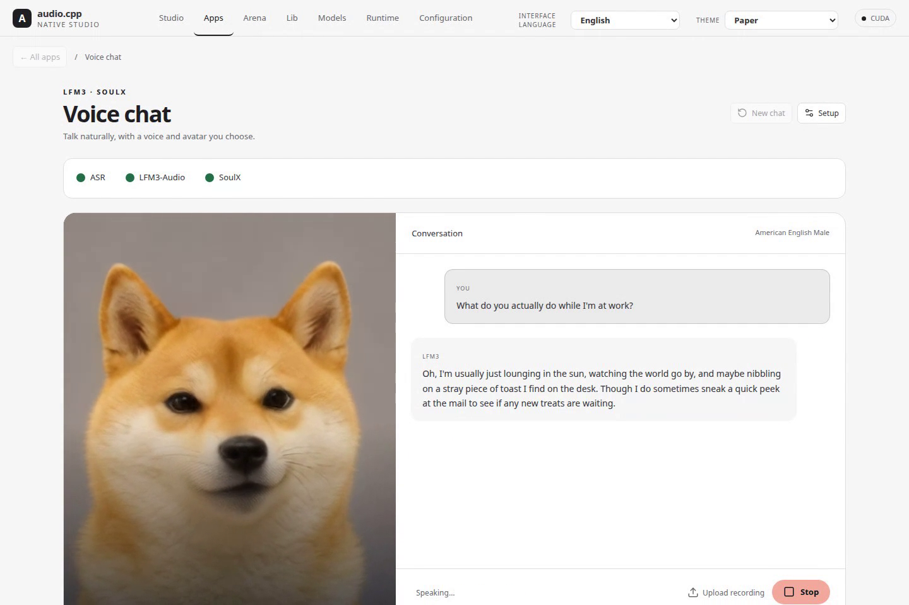

# audio.cpp
<a href="https://trendshift.io/repositories/64983?utm_source=repository-badge&amp;utm_medium=badge&amp;utm_campaign=badge-repository-64983" target="_blank" rel="noopener noreferrer"></a>
[](https://trendshift.io/repositories/64983?utm_source=trendshift-badge&utm_medium=badge&utm_campaign=badge-trendshift-64983)

`audio.cpp` is a high-performance C++ audio inference framework built on top of `ggml`, designed to make modern local audio models practical, portable, and fast.

Tired of juggling a dozen Conda environments, hundreds of Python packages, and dependency conflicts just to try a few audio models? audio.cpp gives those paths a shared native runtime instead. Runs on Windows, Linux, and macOS, with support for NVIDIA, AMD, Apple Silicon, and CPU-only machines.

Lost in a sea of audio model names, papers, and codebases? Explore **100+ audio models** in the [Audio Model Architecture Atlas](https://huggingface.co/spaces/audio-cpp/Audio-Model-Architecture-Atlas) to see how they're built, what they share, and where they differ, whether you're learning or building your own.

[](https://huggingface.co/audio-cpp/audio.cpp-gguf) [](https://www.modelscope.cn/models/HereIsMark/audio.cpp-gguf) [](https://colab.research.google.com/github/0xShug0/audio.cpp/blob/main/Notebooks/colab_audio_cpp.ipynb) [](https://huggingface.co/spaces/audio-cpp/Audio-Model-Architecture-Atlas)

**Supported backends:** [](#linux-build) [](#linux-build) [](#hiprocm-build) [](#linux-build) [](#metal-build) [](#webgpu-build) [](#sycl-build)


> [!TIP]
>
> **v0.9.4 highlights**
>
> **Experimental HIP kernels:** Select `--backend hip --backend-impl gfx1151_v1` to try alternative AMD kernels. On the tested Strix Halo GPU, Q8 generation time fell by **76.7%** for Irodori-TTS Small MF, **30.9%** for Qwen3-TTS 1.7B VoiceDesign, and **14.0%** for BreezeTTS2 versus default HIP. Despite its name, `gfx1151_v1` can also run on RDNA1/2, as well as RDNA3/4; available fast paths vary by architecture. Gains vary by model and hardware; the implementation is opt-in. See the [HIP guide](docs/build/HIP.md#optional-gfx1151_v1-implementation). Contributions are welcome: test other AMD GPUs, report model performance and correctness, or help improve the kernels. Thanks to AMD DevLab for providing hardware access!
>
> **Metal optimizations:** New SSM scan, convolution, and dataflow optimizations reduce RE-USE processing time by **56.5%** on M4 Pro. Parakeet’s channel-contiguous subsampling and matrix projections reduce end-to-end processing time by **12.1–13.9%**, with unchanged transcripts.
>
> **Browser inference with WASM + WebGPU:** Run supported models locally in the browser. On RTX 5090 in Chrome, measured throughput reaches **23.3×** real time for Supertonic 3, **13.9×** for Kokoro, **94.3×** for SenseVoice ASR, and **25.0×** for warmed LFM3-Audio ASR. See the [tested models, settings, and performance table](docs/reports/webgpu_browser_validation.md).
>
> **Experimental streaming avatar voice chat:** Talk to **LFM3-Audio** through the WebUI while **SoulX-FlashHead** animates your chosen portrait. Responses stream as text, speech, and synchronized head animation, with voice selection, adjustable speaking speed, and a customizable personality.
>
> <p align="center"></p>
>

audio.cpp is built for real end-to-end execution rather than one-off model demos. Its optimized, reusable building blocks support speech generation and recognition, separation, alignment, and multi-model workflows. Shared components make new models easier to integrate and let improvements benefit multiple model families while keeping inference efficient, maintainable, and portable.

## Features

⭐ **143 audio model families and 250+ variants.** Run TTS, ASR, music generation, voice cloning, conversion, separation, and more locally through a shared CLI and server API.

⭐ **Built-in WebUI.** Generate and clone voices in Studio, compare models in Arena, manage models and voice libraries, and assemble narration with reusable speakers and passage editing in the TTS app.

⭐ **Performance.** Reusable sessions, cached graphs, and batched offline inference. Selected TTS paths run **1.8–8×** faster than Python; tested Q8 packages deliver up to **1.53×** speedup and **37%** lower peak VRAM versus 16-bit weights ([report](docs/reports/gguf_q8_performance.md)). Supertonic 3 generates **10 hours** of audio in **3 minutes** on RTX 5090 ([demo](https://www.reddit.com/r/LocalLLaMA/comments/1uwpvt9/audiocpp_10_hours_of_audio_generated_in_3_minutes/)), while Nemotron 3.5 ASR matches WER at roughly **¼** the wall time in the [TranscrIA benchmark](https://github.com/Martossien/transcria/blob/main/docs/STT_BENCHMARK_REAL_MEETINGS.md). audio.cpp is among the fastest inference engines for streaming TTS latency on the [Open TTS Leaderboard](https://huggingface.co/spaces/hf-audio/open_tts_leaderboard).

⭐ **Portability.** A native `ggml` runtime supporting CUDA, HIP/ROCm, Vulkan, Metal, WebGPU, SYCL, and CPU through common CLI and server interfaces.

⭐ **Hardware-specific optimizations.** ARM NEON acceleration, Rockchip RKNN component execution, experimental HIP kernels, and CUDA, Metal, and Vulkan optimizations. Model-specific `perf_mode` presets expose optional fast paths for supported hardware.

⭐ **Parity.** Validation tooling for comparing model outputs against Python reference implementations.

⭐ **Integrations and deployment.** Powers speech, music, and transcription in [Unsloth Studio](https://github.com/unslothai/unsloth#audiocpp-audio-engine). Fun-ASR-Nano and SenseVoice can also be deployed through the [FunASR platform](https://www.funasr.com/en/deploy/audio-cpp.html).

## Contributing

audio.cpp would not be moving this quickly without generous contributors bringing in real fixes, new capabilities, and careful polish. See [CONTRIBUTING.md](CONTRIBUTING.md) for how to contribute and for a shout-out to the people already helping shape the project. Before starting a new model port, **check the supported model table because several families are already implemented or under testing**, and read the [New Model PRs section in CONTRIBUTING.md](CONTRIBUTING.md#new-model-prs). New ports should start under the community model source tree, where review is lighter than core models but still needs reproducible validation.

## News

> [!IMPORTANT]
> **2026-11-04 — Release v0.9.4:** **WebGPU support brings audio inference to the browser with WASM**, and the WebUI gains **streaming voice chat with animated SoulX avatars**, cross-language dubbing, and voice-library export, import, and sorting. New models include **Nemotron 3.5 Transcribe** with CPU offload below 7 GB VRAM, **LFM3-Audio, LFM D1-Omni, PocketTTS Small, SoulX-FlashHead, Real-time RE-USE, Magenta RealTime 2, Music Flamingo, Haas, and Underdog Bark 3**, plus Irodori-TTS v4 Large. Experimental AMD kernel selection, new performance controls, and backend fixes improve speed, memory use, and compatibility. This release brings together community model ports, backend optimizations, and fixes shaped by real deployment reports.

**2026-10-26 — Release v0.9.3:** New speech models including Drama3, Ming 3.0 TTS/Audio Tiny, XTTS v2, Plapre 3, Gradium Phonon, and Earshot VAD, plus experimental LatentSync lip sync. Highlights include **LoRA across 11 models**, a **TTS workspace**, voice-cloning and dubbing recipes, `perf_mode` presets, lower memory use, and expanded HIP, ARM NEON, and Rockchip NPU support. Thanks to our contributors!

**2026-10-15 — Release v0.9.2:** New models include Voxtral TTS, TF-GridNet, MossFormer2, Hviske v6, FireRed VAD, AST, CED, and wake-word detection models. This release expands TTS streaming, adds multi-turn LFM2.5-Audio conversations, and improves model performance and compatibility. The WebUI gains a shared Voice Library and layout improvements. Downloadable C API libraries, Windows Vulkan portable builds, and packaged server configuration examples make integration easier. Thanks to everyone contributing code, testing, and feedback!

**2026-09-30 - Release v0.9.0:** **100+ audio models**, an enhancement and denoising WebUI tab, speaker-tagged ASR, and performance and memory improvements. Explore the [Architecture Atlas](https://huggingface.co/spaces/audio-cpp/Audio-Model-Architecture-Atlas). Thanks to our community!

**2026-06-25 to 2026-09-23 (releases 0.1 to 0.8):** audio.cpp grew to **80+ model families and 120+ variants** across TTS, ASR, music generation, voice conversion, separation, and speech analysis. Major additions included the **native WebUI and Arena**, GGUF packaging, LoRA adapters, streaming, and CUDA/Metal performance improvements, alongside Vulkan and experimental HIP support. The C ABI, Colab integration, MP3/HTTPS frontends, and models such as YuE2 and SheetSage2 expanded integration and audio-to-score workflows.

## Supported Models

Task tags: `TTS` text to speech, `Clone` voice cloning, `VC` voice conversion, `S2S` speech-to-speech, `ASR` speech recognition, `Classify` audio classification, `Wake` wake-word detection, `Align` forced alignment, `VAD` voice activity detection, `Diar` speaker diarization, `Codec` audio codec, `Sep` source separation, `MIDI` audio-to-symbolic MIDI/events, `Music` music/song generation, `SFX` sound effects, `Video` video generation, `Edit` audio/music editing, `Design` voice design, `Dialogue` multi-speaker dialogue TTS, `Ctrl` TTS/clone voice control such as emotion, style, instruction, caption, or non-verbal tag control.

Runtime tags summarize the supported loading paths. GGUF package precision varies by model and release; check the [audio.cpp GGUF repo](https://huggingface.co/audio-cpp/audio.cpp-gguf) or [docs/gguf.md](docs/gguf.md) for the exact package list. `Bundled` means the tiny runtime asset ships under `assets/framework/models` and needs no separate model download. `Stream` means the family exposes a streaming server/session path. `LoRA` means adapter loading is supported in audio.cpp; see the [LoRA guide](docs/lora.md) for supported formats and usage.

Model weights keep the license of their original release, which is separate from audio.cpp's own license. [docs/model_licenses.md](docs/model_licenses.md) lists that license per family, and whether it allows commercial use.

**(C) marks a community model;** contributor credits appear below its family name.
Core and community models are grouped by task and listed alphabetically within each group.

### Speech Generation And Conversation

| Family | Task | Lang | Variants | Runtime |
|---|---|---|---|---|
| **audio8_tts** (C)<br>[@jasonchen31](https://github.com/jasonchen31) | TTS, Clone | auto, yue, zh, nl, en, fr, de, it, ja, ko, pl, es | [Audio8 TTS Preview 0.6B](docs/models/audio8_tts.md) | GGUF Q8, Stream |
| **auk** (C) | TTS, audio editing | auto | [AuK Base and AuK-Flash](docs/models/auk.md) | GGUF F32/F16/Q8 |
| **breeze_tts** | TTS, Clone, Design, Ctrl | zh, en | [BreezeTTS 2](docs/models/breeze_tts.md) | GGUF BF16/Q8/Q4_0, Stream |
| **chatterbox** | TTS, Clone, VC | ar, da, de, el, en, es, fi, fr, hi, it, ko, ms, nl, no, pl, pt, sv, sw, tr | [Chatterbox 0.5B](docs/tts.md#chatterbox) | GGUF 16/Q8 |
| **chatterbox_turbo** (C)<br>[@pannagaps](https://github.com/pannagaps) | TTS (testing) | en | [Chatterbox Turbo](docs/models/chatterbox_turbo.md) | GGUF 16/Q8 |
| **confucius4_tts** | TTS, Clone | zh, en, ja, ko, de, fr, es, id, it, th, pt, ru, ms, vi | [Confucius4-TTS](docs/tts.md#confucius4-tts) | GGUF F32, Stream |
| **cosyvoice3** | TTS, Clone | zh, en, ja, ko, de, es, fr, it, ru, yue | [Fun-CosyVoice3](docs/models/cosyvoice3.md) | GGUF F32/Q8, LoRA |
| **dots_tts** | TTS, Clone, Edit, Ctrl | multilingual | [DotTTS SOAR](docs/models/dots_tts.md)<br>DotTTS MeanFlow<br>DotTTS Edit | GGUF 16/Q8, Stream |
| **dramabox** | TTS, Clone | en | [DramaBox](docs/tts.md#dramabox) | GGUF Q8 |
| **echo_tts** (C)<br>[@5uck1ess](https://github.com/5uck1ess) | TTS, Clone | en | [Echo-TTS](docs/models/echo_tts.md) | GGUF 16/Q8 |
| **f5_tts** (C)<br>[@tareko](https://github.com/tareko) | TTS, Clone | en, ar (Habibi) | [F5-TTS / Habibi](docs/models/f5_tts.md) | GGUF, LoRA |
| **firered_audio** | ASR, TTS, Clone, Design, Ctrl | zh, en | [FireRedAudio](docs/models/firered_audio.md) | GGUF original/Q8 |
| **fireredtts3** | TTS, Clone, Design, Ctrl | 24 langs + 21 zh dialects | [FireRedTTS3 Base](docs/models/fireredtts3.md)<br>FireRedTTS3 Instruct/Voicedesign | GGUF original/Q8 |
| **fish_audio** | TTS, Clone, Ctrl | auto, en, zh | [Fish Audio S2 Pro](docs/models/fish_audio.md) | GGUF 16/Q8, Stream, LoRA |
| **fish_drama3** (C)<br>[@JarodMica](https://github.com/JarodMica) (base)<br>[@Th-Underscore](https://github.com/Th-Underscore) (small) | TTS, Clone, Ctrl, Edit | auto | [Drama 3 / Drama3-small](docs/models/fish_drama3.md) | Mixed Q2_K/Q3_K/Q4_K GGUF, IQ3_XXS (small), Stream |
| **glm_tts** (C)<br>Mirek [@mirek190](https://github.com/mirek190) | TTS, Clone | zh, en | [GLM-TTS](docs/models/glm_tts.md) | GGUF |
| **gradium_phonon** | TTS | en | [Gradium Phonon 31M](docs/models/gradium_phonon.md) | GGUF Q8, Safetensors, Stream |
| **higgs_audio_tts** | TTS, Clone, Ctrl | auto | [Higgs Audio v3 TTS 4B](docs/models/higgs_audio_tts.md) | GGUF 16/Q8, Stream |
| **index_tts2** | TTS, Clone, Ctrl | zh, en, ja, es, ar | [IndexTTS-2](docs/models/index_tts2.md)<br>IndexTTS-2.5 | GGUF 16/Q8 |
| **inflect_v2** (C)<br>Jan [@JanWerder](https://github.com/JanWerder) | TTS | en | [Inflect Micro v2 and Nano v2](docs/models/inflect_v2.md) | GGUF FP32 |
| **irodori_tts** | TTS, Clone, Design, Ctrl | ja | [Irodori-TTS-v4.1-Small (RF and MF)](docs/models/irodori_tts.md)<br>Irodori-TTS-v4.1-Anime<br>Irodori-TTS-500M-v3<br>Irodori-TTS-600M-v3-VoiceDesign | GGUF 16/Q8 |
| **kitten_tts** (C)<br>Community | TTS | en | [KittenTTS Mini 0.8](docs/models/kitten_tts.md) | GGUF FP32 |
| **kitten_tts2** (C)<br>[@dignome](https://github.com/dignome) | TTS, Clone | en, ar, zh, fr, de, hi, it, pt, ru, es, nl, id, ja, ko, pl, tr | [Kitten TTS 2](docs/models/kitten_tts2.md) | GGUF Q8/Q4 |
| **kokoro_tts** | TTS | en-us, en-gb, es, fr, hi, it, ja, pt-br, zh | [Kokoro 82M](docs/models/kokoro_tts.md) | Safetensors, local GGUF BF16/Q8, Stream |
| **kugelaudio** | TTS, Clone | European multilingual | [KugelAudio-0-Open](docs/models/kugelaudio.md) | GGUF BF16 / Q8_0 / Q4_K, Stream |
| **lfm2_audio** (C)<br>[@ykhrustalev](https://github.com/ykhrustalev) / Liquid AI | ASR, TTS, S2S · Conversation | en, ja | [LFM2.5-Audio](docs/models/lfm2_audio.md) | GGUF F32/16/Q8/Q4, Stream |
| **lfm3_audio** (C)<br>Community | ASR, TTS, S2S · Conversation | en, ar, da, de, el, es, fi, fr, he, it, ja, ko, nl, pl, pt, sv, tr, zh | [LFM3-Audio](docs/models/lfm3_audio.md) | GGUF BF16/16/Q8/Q4, Safetensors, Stream, experimental |
| **magpie_tts** | TTS | ar-AE, ar-MSA, ar-SA, de, en, es, fr, hi, it, ko, pt-BR, vi, zh | [MagpieTTS Multilingual 357M (v2607)](docs/models/magpie_tts.md) | GGUF original/Q8 |
| **maya1** | TTS, Design, Ctrl | en | [Maya1](docs/models/maya1.md) | GGUF original/Q8 |
| **ming3_tts** | TTS, Clone, Design, Ctrl | zh, en, ja, ko, de, fr, es | [Ming 3.0 TTS 0.5B](docs/models/ming3_tts.md) | GGUF BF16/Q8, Stream |
| **miotts** | TTS, Clone | en, ja | [MioTTS-1.7B](docs/models/miotts.md) | GGUF 16/Q8 |
| **mira_tts** (C)<br>Mirek [@mirek190](https://github.com/mirek190) | TTS, Clone | en | [MiraTTS](docs/models/mira_tts.md) | Local conversion |
| **moss_tts_local**<br>[@justinjohn0306](https://github.com/justinjohn0306) | TTS, Clone, Ctrl | auto, optional language hint | [MOSS-TTS-Local-Transformer-v1.5](docs/models/moss_tts_local.md) | GGUF 16/Q8 |
| **moss_tts_nano** | TTS, Clone | auto | [MOSS-TTS-Nano-100M](docs/models/moss_tts_nano.md) | GGUF 16/Q8, Stream |
| **moss_tts_v15** (C)<br>Chris [@christopherthompson81](https://github.com/christopherthompson81) | TTS, Clone | en, zh | [MOSS-TTS-v1.5](docs/models/moss_tts_v15.md) | GGUF |
| **moss_ttsd** (C)<br>Chris [@christopherthompson81](https://github.com/christopherthompson81) | TTS, Clone, Dialogue | en, zh | [MOSS-TTSD](docs/models/moss_ttsd.md) | GGUF BF16/Q8/Q4 |
| **moss_voicegen** (C)<br>Joost [@jrohde](https://github.com/jrohde) | Voice Design | en, zh | [MOSS-VoiceGenerator](docs/models/moss_voicegen.md) | GGUF |
| **neutts** | TTS, Ctrl | en | [NeuTTS 2E](docs/models/neutts.md) | GGUF original precision, Stream |
| **omnivoice** | TTS, Clone, Design, Ctrl | 646+ langs | [OmniVoice](docs/models/omnivoice.md)<br>VoiceTut-TTS (Egyptian Arabic) | GGUF 16/Q8, Stream |
| **outetts** (C)<br>Mirek [@mirek190](https://github.com/mirek190) | TTS, Clone | en, ar, zh, nl, fr, de, it, ja, ko, lt, ru, es, pt, be, bn, ka, hu, lv, fa, pl, sw, ta, uk | [OuteTTS 1.0 1B](docs/models/outetts.md) | GGUF, LoRA |
| **personaplex** | Dialogue, S2S · Conversation | en | [PersonaPlex 7B v1](docs/models/personaplex.md) | GGUF Q4/Q8, Stream |
| **piper_tts** (C)<br>Community | TTS | en | [Piper TTS](docs/models/piper_tts.md) | GGUF FP32 |
| **plapre** | TTS, Clone, Ctrl, Edit | da | [Plapre 3](docs/models/plapre.md) | GGUF F32/BF16, Stream |
| **pocket_tts** | TTS, Clone | en, fr, de, it, pt, es | [PocketTTS 100M](docs/tts.md#pockettts) | GGUF 16/Q8, Stream |
| **pocket_tts_small** | TTS, Clone | en | [PocketTTS Small 18M / 7M / 2M](docs/models/pocket_tts_small.md)<br>Base / ReFL | GGUF F32, Stream |
| **qwen3_tts** | TTS, Clone, Design, Ctrl | zh, en, fr, de, it, ja, ko, pt, ru, es | [Qwen3-TTS 0.6B Base](docs/models/qwen3_tts.md)<br>1.7B Base / CustomVoice / VoiceDesign | GGUF 16/Q8, Stream, LoRA |
| **sanotts** (C)<br>Ashish [@voidash](https://github.com/voidash) | TTS | en, vi, id, cs, de, es, fr, it, pt, ro, ru, tr, ne, hi | [sanoTTS voice family](docs/models/sanotts.md) | GGUF FP32 |
| **soprano_tts** (C)<br>[@drzsdrtfg](https://github.com/drzsdrtfg) | TTS | en | [Soprano 1.1 80M](docs/models/soprano_tts.md) | GGUF Q8, Stream |
| **sopro_tts** (C)<br>[@Brioch](https://github.com/Brioch)<br>[@samuel-vitorino](https://github.com/samuel-vitorino) | TTS, Clone | en, pt, fr, de | [Sopro V2 Turbo (2.2.0)](docs/models/sopro_tts.md) | Safetensors, GGUF F16, Stream |
| **supertonic** | TTS | en, ko, ja, ar, bg, cs, da, de, el, es, et, fi, fr, hi, hr, hu, id, it, lt, lv, nl, pl, pt, ro, ru, sk, sl, sv, tr, uk, vi, na | [Supertonic 3](docs/tts.md#supertonic) | GGUF F32, Stream |
| **vibevoice** | TTS, Dialogue | en, zh | [VibeVoice-1.5B](docs/tts.md#vibevoice)<br>VibeVoice-7B | GGUF 16/Q8, Stream, LoRA |
| **vieneu_v3_turbo** (C)<br>Bảo [@pnnbao97](https://github.com/pnnbao97)<br>[@phuocnguyen90](https://github.com/phuocnguyen90) | TTS, Clone | vi, en | [VieNeu-TTS v3 Turbo](docs/models/vieneu_v3_turbo.md) | GGUF |
| **voxcpm1** (C)<br>[@jasonchen31](https://github.com/jasonchen31) | TTS, Clone | zh, en, ja, ko | [VoxCPM1](docs/models/voxcpm1.md) | GGUF Q8, Stream, LoRA |
| **voxcpm2** | TTS, Clone, Design, Ctrl | ar, da, de, el, en, es, fi, fr, he, hi, id, it, ja, km, ko, lo, ms, my, nl, no, pl, pt, ru, sv, sw, th, tl, tr, vi, zh | [VoxCPM2-2B](docs/tts.md#voxcpm2)<br>VocalRender-Pro | GGUF 16/Q8, Stream, LoRA |
| **voxtral_tts** | TTS | en, fr, es, de, it, pt, nl, ar, hi | [Voxtral-4B-TTS-2603](docs/models/voxtral_tts.md) | GGUF BF16/Q8, Stream |
| **xtts_v2** (C)<br>[@whoreson](https://github.com/whoreson) | TTS, Clone | en, es, fr, de, it, pt, pl, tr, ru, nl, cs, ar, zh-cn, hu, ko, ja, hi | [Coqui XTTS v2](docs/community_models/xtts_v2.md) | GGUF original/Q8_0/Q4_K_M |
| **zipvoice** (C)<br>Community | TTS, Clone | zh, en | [ZipVoice](docs/models/zipvoice.md) | GGUF F32, Stream |
| **zonos2** (C)<br>[@Ryu1845](https://github.com/Ryu1845) | TTS, Clone | en, fr, de, es, it, pt, ja, zh, ko | [ZONOS2](docs/models/zonos2.md) | GGUF Q8_0, Stream |
| **zonos3** (C)<br>[@Ryu1845](https://github.com/Ryu1845) | TTS, Clone | en, fr, de, es, it, pt, ja, zh, ko | [ZONOS3-Mini](docs/models/zonos3.md) | GGUF Q4_0/Q8_0, Stream |

### Speech Recognition And Analysis

| Family | Task | Lang | Variants | Runtime |
|---|---|---|---|---|
| **ast_audioset** | Classify | language agnostic | [AST AudioSet](docs/models/ast_audioset.md) | GGUF F32 |
| **audio8_asr** (C)<br>[@gqf2008](https://github.com/gqf2008) | ASR | en, zh, yue, ja, ko, fr, de | [Audio8-ASR-0.1B](docs/models/audio8_asr.md) (local conversion) | GGUF Q8, Safetensors |
| **audio_flamingo** | ASR, Audio understanding | en | [Audio Flamingo 3 / Next](docs/models/audio_flamingo.md)<br>Music Flamingo 2601<br>SpotSound | GGUF BF16/Q8/Q4, LoRA |
| **canary_asr** | ASR, Translate | en, de, es, fr | [Canary 180M Flash](docs/models/canary_asr.md) | GGUF F32/Q8 |
| **ced** | Classify | language agnostic | [CED Tiny / Mini / Small / Base](docs/models/ced.md) | GGUF F32 |
| **citrinet_asr** | ASR | en | [Citrinet-256](docs/asr.md#citrinet-asr) | GGUF Q8 |
| **cohere_asr** | ASR | en, fr, de, es, it, pt, nl, pl, el, ar, ja, zh, vi, ko | [Cohere Transcribe 03-2026](docs/models/cohere_asr.md) | GGUF BF16/Q8/Q4_0 |
| **confucius4_r2t2** (C)<br>[@davidxifeng](https://github.com/davidxifeng) | ASR | 30 languages | [Confucius4-R2T2](docs/models/r2t2.md) | Safetensors, GGUF F16/Q8/Q4, Stream |
| **crisperwhisper** | ASR, Align | 99 language codes | [CrisperWhisper 2.0 Large](docs/models/crisperwhisper.md) | GGUF BF16/Q8, Stream |
| **earshot_vad** (C)<br>[@Etherll](https://github.com/Etherll) | VAD | lang agnostic | [Earshot VAD](docs/models/earshot_vad.md) | Bundled, Stream |
| **edda_asr** (C)<br>Lars Karlslund [@lkarlslund](https://github.com/lkarlslund) | ASR | da | [Edda v0.2 large](docs/models/edda_asr.md) | Safetensors, GGUF 16/Q8, Stream |
| **firered_vad** | VAD | lang agnostic | [FireRed VAD / Stream-VAD](docs/models/firered_vad.md) | GGUF F32/F16/Q8, Stream |
| **fun_asr_nano**<br>[@LauraGPT](https://github.com/LauraGPT) (FunASR team) | ASR | auto, zh, en, ja | [Fun-ASR-Nano-2512](docs/models/fun_asr_nano.md) | GGUF 16/Q8 |
| **gigaam_asr** | ASR | ru, kk, ky, uz, en | [GigaAM v3 CTC](docs/models/gigaam_asr.md)<br>GigaAM v3 RNN-T<br>GigaAM v3 E2E CTC<br>GigaAM v3 E2E RNN-T<br>GigaAM Multilingual CTC<br>GigaAM Multilingual Large CTC | GGUF F16/F32 |
| **granite5asr** (C)<br>[@ampersandru](https://github.com/ampersandru) | ASR | en, fr, de, es, pt, it, ja | [IBM Granite Speech 5.0 470M TurboCTC](docs/models/granite5asr.md) | GGUF Q8 |
| **haas_asr** (C)<br>Third Intelligence | ASR | ja | [Haas-ja-v1.0](docs/models/haas.md) | GGUF F16/Q8, Stream |
| **higgs_audio_stt** | ASR | en | [Higgs Audio v3 STT](docs/models/higgs_audio_stt.md) | GGUF 16/Q8, Stream |
| **hviske_asr** | ASR | da | [Hviske v5.3](docs/asr.md#hviske-asr) | GGUF Q8 |
| **hviske_asr_v6** | ASR | da | [Hviske v6](docs/models/hviske_asr_v6.md) | GGUF BF16 / Q8 |
| **index_echo** | ASR, Translate | zh → en, es, ja | [Index-Echo-S2TT 2B](docs/models/index_echo.md)<br>Index-Echo-S2TT 9B | GGUF original/Q8_0/Q4_K |
| **kroko_asr** (C)<br>Mirek [@mirek190](https://github.com/mirek190) | ASR | de, en, es, fr, it, he, nl, pt, sv, tr | [Kroko Community ASR](docs/models/kroko_asr.md) | Safetensors, GGUF Q8 |
| **lfm_d1_omni** | Classify | multilingual | [d1-Omni-2B](docs/models/lfm_d1_omni.md) | GGUF Q8_0/F16/BF16 |
| **marblenet_vad** | VAD | lang agnostic | [MarbleNet VAD](docs/speech_analysis.md#marblenet-vad) | Bundled |
| **micro_wake_word** | Wake | model dependent | [microWakeWord MixedNet](docs/models/micro_wake_word.md) | GGUF F32, Stream |
| **ming3_audio** | ASR, Understanding, TTS, Clone<br>S2S · Conversation | zh, en | [Ming 3.0 Audio Tiny](docs/models/ming3_audio.md) | GGUF BF16/Q8_0/Q4_K |
| **mms_forced_aligner** (C)<br>[@LysanderdeJong](https://github.com/LysanderdeJong) | Align | nl (nld), en (eng); pre-romanized Latin | [MMS-300M-1130 Forced Aligner](docs/models/mms_forced_aligner.md) | Safetensors, GGUF 16/Q8 |
| **moonshine_asr** | ASR | en | [Moonshine Streaming Tiny/Small/Medium](docs/models/moonshine_asr.md) | GGUF Q8, Stream |
| **moss_transcribe_diarize** | ASR | auto, 50+ languages | [MOSS-Transcribe-Diarize](docs/models/moss_transcribe_diarize.md) | GGUF BF16/Q8/Q4_K, Stream |
| **nemotron_3_diar** | Diar | multilingual | [Nemotron 3 Diarization](docs/models/nemotron_3_diar.md) | GGUF BF16, Batch, Stream |
| **nemotron_asr** | ASR | 100+ ASR prompt codes incl. auto | [Nemotron 3.5 ASR Streaming 0.6B](docs/asr.md#nemotron-asr) | GGUF 16/Q8, Stream |
| **nemotron_transcribe** (C)<br>[@JarodMica](https://github.com/JarodMica) | ASR, translation, audio Q&A | auto | [NVIDIA Nemotron 3.5 Transcribe 30B-A4B](docs/models/nemotron_transcribe.md) | [IQ4_NL / Q4_K / Q3_K / Q2_K experts](https://huggingface.co/Jmica/NVIDIA-Nemotron-3.5-Transcribe-30B-A4B-GGUF) |
| **niagara_asr** | ASR | en | [Niagara 19M Batch English](docs/asr.md#niagara-asr)<br>Niagara 38M Batch English | GGUF F32 |
| **open_wake_word** | Wake | en | [OpenWakeWord Alexa](docs/models/open_wake_word.md) | GGUF F32, Stream |
| **owsm** | ASR, Translate | 151 language codes | [OWSM v4 Base 102M](docs/models/owsm.md)<br>OWSM v4 Small 370M<br>OWSM v4 Medium 1B | GGUF F32 / Q8_0 / Q4_K (Small, Medium) |
| **owsm_ctc** | ASR, Translate | 151 language codes | [OWSM-CTC v4 1B](docs/models/owsm_ctc.md) | GGUF F32 / Q8_0 |
| **parakeet_tdt** (C)<br>[@dleiferives](https://github.com/dleiferives) | ASR | auto, bg, cs, da, de, el, en, es, et, fi, fr, hr, hu, it, lt, lv, mt, nl, pl, pt, ro, ru, sk, sl, sv, uk | [Parakeet-TDT 0.6B v3 / Orukeet r3](docs/models/parakeet_tdt.md) | GGUF F32/16/Q8, Stream |
| **phonon2_asr** (C)<br>Mirek [@mirek190](https://github.com/mirek190) | ASR | en | [Phonon-2](docs/models/phonon2_asr.md) | GGUF F32/16/BF16/Q8, Stream |
| **pulsevad** | VAD | lang agnostic | [PulseVAD 2.1K Student / 81K Teacher](docs/models/pulsevad.md) | GGUF F32 |
| **qwen3_asr** | ASR | zh, en, yue, ar, de, fr, es, pt, id, it, ko, ru, th, vi, ja, tr, hi, ms, nl, sv, da, fi, pl, cs, fil, fa, el, ro, hu, mk | [Qwen3-ASR 0.6B / 1.7B](docs/models/qwen3_asr.md)<br>QwenCleo-ASR (Egyptian Arabic) | GGUF 16/Q8, Stream, LoRA |
| **qwen3_forced_aligner** | Align | zh, yue, en, de, es, fr, it, pt, ru, ko, ja | [Qwen3-ForcedAligner-0.6B](docs/models/qwen3_forced_aligner.md) | GGUF 16/Q8 |
| **samsone** | Audio understanding | en | [SAMSONE 99M](docs/models/samsone.md)<br>SAMSONE 134M<br>SAMSONE 356M | GGUF BF16/Q8 |
| **sense_asr** (C)<br>Jason Chen [@jasonchen31](https://github.com/jasonchen31)<br>[@LauraGPT](https://github.com/LauraGPT) / FunASR | ASR | auto, zh, en, yue, ja, ko, pt, ru, es, it, fr, de, nl, pl, tr, ar, hi, vi, th, id, ms, fa, nospeech | [SenseVoice-Small](docs/models/sense_asr.md) | GGUF Q8, Stream |
| **sherpa_kws** | Wake | model dependent | [sherpa-onnx Zipformer](docs/models/sherpa_kws.md) | GGUF F32, Stream |
| **silero_vad** | VAD | lang agnostic | [Silero VAD](docs/speech_analysis.md#silero-vad) | Bundled, Stream |
| **smart_turn** | Turn detection | auto | [Smart Turn v3.2](docs/models/smart_turn.md) | GGUF F32 |
| **sortformer_diar** | Diar | en | [Sortformer-4spk-v1](docs/speech_analysis.md#sortformer-diarization) | - |
| **sortformer_diar_v2** (C)<br>[@LysanderdeJong](https://github.com/LysanderdeJong) | Diar | multilingual | [Sortformer v2.1](docs/models/sortformer_diar_v2.md) (local conversion) | GGUF F32/mixed F16, Stream |
| **underdog_bark3** (C)<br>Mirek [@mirek190](https://github.com/mirek190) | ASR | en | [Underdog Bark 3 Standard/Plus/Pro](docs/models/underdog_bark3.md) | GGUF F32/16/BF16/Q8, Stream |
| **vibeasr** (C)<br>[@XsquirrelC](https://github.com/XsquirrelC) / VibeASR | ASR | en | [VibeASR](docs/models/vibeasr.md) (CPU only) | GGUF I8_S + I2_S |
| **vibevoice_asr** | ASR | auto | [VibeVoice ASR](docs/models/vibevoice_asr.md) | GGUF 16/Q8 |
| **vibevoice_asr_streaming** | ASR | en, zh, es, pt, de, ja, ko, fr, ru, it | [VibeVoice ASR Streaming 7B / 1.5B](docs/models/vibevoice_asr.md#vibevoice-asr-streaming-7b) | GGUF BF16/Q8/Q4, Stream |
| **voxtral_realtime** | ASR | auto | [Voxtral-Mini-4B-Realtime-2602](docs/models/voxtral_realtime.md) | GGUF 16/Q8/Q4, Stream |
| **whistle_asr** (C)<br>[@bumpyclock](https://github.com/bumpyclock) | ASR | en, de, fr, es, it, nl, pl | [Whistle ASR](docs/models/whistle_asr.md) | GGUF F32, Safetensors F32 |

### Audio Conversion And Processing

| Family | Task | Lang | Variants | Runtime |
|---|---|---|---|---|
| **apollo** | S2S · Music restoration | lang agnostic | [Apollo](docs/models/apollo.md) | GGUF F32 |
| **audiosr** | S2S · Super-resolution | lang agnostic | [AudioSR Basic](docs/models/audiosr.md) | GGUF F32 |
| **bs_roformer**<br>[@mirek190](https://github.com/mirek190) | Sep | lang agnostic | [BS-RoFormer](docs/audio_tools.md#bs-roformer) | GGUF Q8 |
| **builtin_audio_utils** | S2S · Denoising / Enhancement | lang agnostic | [RNNoise](docs/audio_tools.md#built-in-audio-utilities)<br>DeepFilterNet2<br>ZipEnhancer<br>GTCRN Streaming<br>GTCRN DNS3<br>GTCRN VCTK<br>FlashSR | Safetensors |
| **controlfoley** | SFX | auto | [ControlFoley](docs/models/controlfoley.md) | GGUF F32/Q8 |
| **htdemucs** | Sep | lang agnostic | [HTDemucs](docs/audio_tools.md#htdemucs)<br>HTDemucs_ft<br>HTDemucs_6stems | GGUF 16/Q8 |
| **meanvc2** | VC | lang agnostic | [MeanVC2 120 ms / 40 ms](docs/models/meanvc2.md) | GGUF F32/Q4, Stream |
| **mel_band_roformer** | Sep | lang agnostic | [Mel-Band RoFormer](docs/audio_tools.md#mel-band-roformer) | GGUF 16/Q8 |
| **miocodec** | Codec, VC | lang agnostic | [MioCodec v2](docs/audio_tools.md#miocodec) | GGUF 16/Q8 |
| **mossformer2** | Sep, S2S · Enhancement / Super-resolution | lang agnostic | [MossFormer2 SS 16K / SE 48K / SR 48K](docs/models/mossformer2.md) | GGUF F32/F16 |
| **muscriptor** | MIDI | music | [MuScriptor Small/Medium/Large](docs/models/muscriptor.md) | GGUF F32, Stream |
| **realtime_reuse** (C) | S2S · Speech enhancement | lang agnostic | [Real-time RE-USE](docs/models/realtime_reuse.md) | GGUF F32, Stream |
| **reuse** (C) | S2S · Speech restoration | lang agnostic | [RE-USE](docs/models/reuse.md) | GGUF F32/F16/Q8_0 |
| **rvc** | VC | lang agnostic | [RVC v1 / v2](docs/audio_tools.md#rvc) | GGUF 16 |
| **sam_audio** | S2S · Sound separation | lang agnostic | [SAM Audio Small](docs/models/sam_audio.md)<br>SAM Audio Base<br>SAM Audio Large | GGUF F32/BF16/Q8 |
| **seed_vc** | VC | lang agnostic | [SeedVC XLS-R + HiFT](docs/models/seed_vc.md)<br>SeedVC Whisper-small + BigVGAN | GGUF 16/Q8 |
| **sheetsage2** | MIDI | music | [SheetSage2](docs/audio_tools.md#sheetsage2) | GGUF orig |
| **sidon** | S2S · Speech restoration | lang agnostic | [Sidon v0.1](docs/models/sidon.md) | GGUF F32 |
| **tf_gridnet** | Sep | lang agnostic | [TF-GridNet WSJ0-2mix](docs/models/tf_gridnet.md) | GGUF F32 |
| **tone_color_vc** | VC | lang agnostic | [Tone Color VC](docs/models/tone_color_vc.md) | GGUF F32/F16 |
| **universr** | S2S · Super-resolution | lang agnostic | [UniverSR Audio / Speech](docs/models/universr.md) | GGUF F32 |

### Music, Media, And Editing

| Family | Task | Lang | Variants | Runtime |
|---|---|---|---|---|
| **ace_step** | Music, Edit | 50+ langs | [ACE-Step 1.5 Turbo](docs/models/ace_step.md)<br>ACE-Step 1.5 Base<br>ACE-Step 1.5 XL Turbo<br>ACE-Step 1.5 XL SFT | GGUF 16, LoRA |
| **heartmula** | Music | zh, en, ja, ko, es | [HeartMuLa-oss-3B](docs/music_generation.md#heartmula) | GGUF 16/Q8 |
| **latentsync** (C) | Video lip sync | lang agnostic | [LatentSync 1.6](docs/models/latentsync.md) | GGUF F32/F16/Q8, experimental |
| **liveavatar** (C) | Audio-to-video | auto | [LiveAvatar](docs/models/liveavatar.md) | GGUF NVFP4 |
| **magenta_realtime_2** | Music | music | [Magenta RealTime 2 Small / Base](docs/models/magenta_realtime_2.md) | GGUF F16/Q8_0, Stream |
| **midashenglm_gen** | Music, SFX | auto | [MiDashengLM-Gen](docs/models/midashenglm_gen.md) | GGUF F32/Q8 |
| **minimax_h3** (C) | Video, Music, TTS/Dialogue | auto | [MiniMax-H3](docs/models/minimax_h3.md) | GGUF Q4/INT8 |
| **minimax_music3** (C)<br>[@0xShug0](https://github.com/0xShug0)<br>[@JoeMattie](https://github.com/JoeMattie) | Music | auto | [MiniMax Music 3](docs/models/minimax_music3.md) | GGUF Q4/Q8 |
| **moss_soundeffect** | SFX | en, zh | [MOSS-SoundEffect v2](docs/models/moss_soundeffect.md) | GGUF BF16/Q8 |
| **mulacover** | Music | multilingual | [MuLaCover](docs/models/mulacover.md) | GGUF 16/Q8 |
| **soulx_flashhead** | Audio-to-video | lang agnostic | [SoulX-FlashHead Lite](docs/models/soulx_flashhead.md) | GGUF Q8/BF16, Stream |
| **stable_audio** | Music, SFX, Edit | en | [Stable Audio 3 Small Music](docs/models/stable_audio.md)<br>Stable Audio 3 Small SFX<br>Stable Audio 3 Medium | GGUF 16/Q8 |
| **vevo2** | TTS, Music, VC, Edit | en, zh | [Vevo2](docs/models/vevo2.md) | GGUF 16 |
| **yue2** | Music | en | [YuE2-3B](docs/models/yue2.md) | GGUF BF16/Q8/Q4, LoRA |

## Prebuilt Binaries

Official packages for every release are attached to the [Releases page](https://github.com/0xShug0/audio.cpp/releases):

| Platform | Backends |
|---|---|
| Windows x64 | CPU, Vulkan, CUDA (12.4 / 13.3), HIP/ROCm (test) |
| Ubuntu x64 | CPU, Vulkan, HIP/ROCm (test) |
| macOS (arm64 / x64) | Metal |

The Windows CUDA packages ship the CUDA runtime in a separate `cudart` archive. Extract it next to the binaries so the CUDA backend can load `ggml-cuda.dll` and the CUDA runtime DLLs (`cudart`, cuBLAS, cuFFT).

- **HIP/ROCm (AMD GPUs):** Official Windows and Ubuntu **test builds** are available on the [Releases page](https://github.com/0xShug0/audio.cpp/releases). GPU compatibility and model coverage are still being validated; please report issues with your GPU, driver version, and reproduction command.
- **Older community Windows HIP packages:** [@IIIIIllllIIIIIlllll's fork Releases](https://github.com/IIIIIllllIIIIIlllll/audio.cpp/releases) provides v0.9.0 packages with the ROCm runtime bundled, in ROCm 6.4 and 7.1 tracks. See [docs/build/windows-hip-distribution.md](docs/build/windows-hip-distribution.md) for packaging details.


### Homebrew Install

On macOS, audio.cpp can be installed from the Homebrew tap:

```bash
brew tap 0xShug0/audio-cpp
brew trust 0xShug0/audio-cpp
brew install audio-cpp
```

## WebUI


[](https://colab.research.google.com/github/0xShug0/audio.cpp/blob/main/Notebooks/colab_audio_cpp.ipynb)

`audiocpp_server` includes an embedded SvelteKit/TypeScript WebUI for running local TTS, cloning, ASR,
generation, conversion, separation, VAD, diarization, and alignment workflows. The production UI is compiled
into the server binary, so using it requires neither Python nor separate frontend files:

```bash
audiocpp_server --ui --ui-management --backend cuda
```

Open `http://127.0.0.1:8080`. `--ui-management` enables catalog browsing, downloads, temporary
uploads, and dynamic model switching, so this is the easiest way to try audio.cpp without writing a
server config first. For a locked-down config-driven instance, start with `--ui` and a server config
instead; in that mode the UI only offers models declared by the config unless management is enabled.

For Docker UI downloads, mount a writable models directory at `/app/models` and
use `--ui-management`. See [docker.md](docs/docker.md#native-webui).

The native UI also provides background model downloads, long-text split-and-merge synthesis,
a browser-local saved voice library, microphone recording, and near-live ASR input. Normal managed
browser downloads use the native C++ package manager and require no Python. Legacy checkpoint
conversion remains available separately through the deprecated Python manager. See
[webui/README.md](webui/README.md) for launch commands and frontend instructions.


## Docker

Docker CUDA and CPU images are available for both CLI and server use. See [docker.md](docs/docker.md) for
available images, build commands and working Docker examples.

## Model Manager and GGUF Downloads

Download packages from the WebUI's **Models** tab or use a command-line manager.
`model_specs/*.json` declares each package's source, precision and complete file set.

Native builds with `-DAUDIOCPP_BUILD_NATIVE_MODEL_MANAGER=ON` provide
`audiocpp_model_manager`, which shares the C++ downloader used by the managed WebUI
and requires no Python. Select an exact package ID from `list`:

```bash
audiocpp_model_manager list
audiocpp_model_manager install qwen3_asr_0_6b_q8_0 --models-root models
```

From the source checkout, Python 3 users can alternatively run:

```bash
python3 tools/model_manager_v2.py install qwen3_asr_0_6b_q8_0 --models-root models
```

Python v2 also supports family defaults and precision filters. Check the install
root: CLI `models` is relative to the working directory, while the server's default
is beside its executable. Use the same explicit folder to share downloads.
The separate `tools/model_manager_deprecated.py` is only for legacy conversions.

GGUF downloads:

- Official model packages: [audio-cpp on Hugging Face](https://huggingface.co/audio-cpp)
- Community-hosted model packages: see the individual model guides linked in the supported model tables for repositories and download instructions.

See the [Model Manager guide](docs/model_manager.md) for model-manager usage and
package notes.


## Build yourself

The commands below enable deployment builds so CLI/server binaries include the
model-spec catalog for standalone loading and legacy GGUF contracts. This avoids
depending on the working directory to locate those specs. It does not rewrite
metadata already embedded in a GGUF.

| OS | Requirements |
|---|---|
| Linux | GCC 13 or newer, CMake, plus the backend toolchain for the build you want: NVIDIA CUDA Toolkit for CUDA, Vulkan SDK for Vulkan, ROCm for HIP |
| Windows | Visual Studio Build Tools 2022 or newer with C++ desktop workload, MSVC x64 compiler, Windows SDK, CMake, Ninja, MSVC OpenMP components; official NVIDIA CUDA Toolkit for CUDA builds, Vulkan SDK for Vulkan builds, AMD HIP SDK for HIP builds |
| macOS | Xcode or Xcode Command Line Tools, plus CMake. Metal builds also require the Metal compiler available through `xcrun` |

<a id="composite-builds"></a>
<details>
<summary><strong>Composite Builds</strong></summary>

Composite builds let you compile only the model families you need. `full` is the default and is what release/Docker builds should use. `custom` registers only the requested loaders while still linking required internal dependencies; `core` builds the runtime without the optional model-family set.

The helper scripts expose this as `--model-set` and `--models` on Linux/macOS, and `-ModelSet` and `-Models` on Windows:

```bash
scripts/build_linux.sh --deployment-build --backend cuda --model-set custom --models qwen3_tts,pocket_tts,qwen3_asr --target audiocpp_cli
```

Direct CMake builds use the same underlying variables:

```bash
cmake -S . -B build/debug -DCMAKE_BUILD_TYPE=Debug -DAUDIOCPP_MODEL_SET=custom -DAUDIOCPP_MODELS=qwen3_tts,pocket_tts,qwen3_asr -DAUDIOCPP_DEPLOYMENT_BUILD=ON
cmake --build build/debug --target audiocpp_cli -j 8
```

</details>

<a id="linux-build"></a>
<details>
<summary><strong>Linux Build</strong></summary>

Use the Linux helper script for CPU, CUDA, Vulkan, or HIP builds:

```bash
scripts/build_linux.sh --deployment-build --backend cuda --target audiocpp_cli --target audiocpp_server
scripts/build_linux.sh --deployment-build --backend vulkan --target audiocpp_cli --target audiocpp_server
scripts/build_linux.sh --deployment-build --backend hip --target audiocpp_cli --target audiocpp_server
scripts/build_linux.sh --deployment-build --backend cpu --target audiocpp_cli --target audiocpp_server
```

The script writes to aligned build directories such as `build/linux-cuda-release`, `build/linux-vulkan-release`, `build/linux-hip-release`, and `build/linux-cpu-release`.

Without `--cuda-arch`, CUDA builds use the portable arch list (works on many
GPUs, slower to build). For a faster build targeting only the local GPU, pass
`--cuda-arch native` (CMake >= 3.24; on older CMake this falls back to the
portable list) or an explicit arch list:

```bash
scripts/build_linux.sh --deployment-build --backend cuda --cuda-arch native --target audiocpp_cli --target audiocpp_server
scripts/build_linux.sh --deployment-build --backend cuda --cuda-arch "86;89" --target audiocpp_cli --target audiocpp_server
```

Nothing caches compiler output by default. `--ccache` wires ccache up as the
compiler launcher, which leaves a cold build about as slow as it already is and
makes a rebuild roughly 14x faster. A `CMAKE_<LANG>_COMPILER_LAUNCHER` already
set in the environment is left alone.

```bash
scripts/build_linux.sh --deployment-build --backend cuda --cuda-arch native --ccache --target audiocpp_cli
```

Composite examples:

```bash
scripts/build_linux.sh --deployment-build --backend cuda --model-set full --target audiocpp_cli
scripts/build_linux.sh --deployment-build --backend cuda --model-set custom --models qwen3_tts,pocket_tts,qwen3_asr --target audiocpp_cli
scripts/build_linux.sh --deployment-build --backend cpu --model-set core --target audiocpp_cli
```

For portable CPU kernels on machines where native ISA flags are not suitable:

```bash
scripts/build_linux.sh --deployment-build --backend cuda --native-cpu OFF --target audiocpp_cli --target audiocpp_server
```

For native WebUI model downloads, enable the native model manager:

```bash
scripts/build_linux.sh --deployment-build --backend cuda --native-model-manager --target audiocpp_server
```

For direct CMake commands, see [docs/build/linux.md](docs/build/linux.md).
For the opt-in Rockchip NPU (RKNN) decoder path, see
[docs/build/rockchip-npu.md](docs/build/rockchip-npu.md).

</details>

<a id="windows-build"></a>
<details>
<summary><strong>Windows Build</strong></summary>

Use the Windows PowerShell build script:

```powershell
powershell.exe -NoProfile -ExecutionPolicy Bypass -File .\scripts\build_windows.ps1 -DeploymentBuild
```

Common presets:

```powershell
.\scripts\build_windows.ps1 -Preset windows-cuda-release -Target audiocpp_cli -DeploymentBuild
.\scripts\build_windows.ps1 -Preset windows-vulkan-release -Target audiocpp_cli -DeploymentBuild
.\scripts\build_windows.ps1 -Preset windows-cpu-release -Target audiocpp_cli -DeploymentBuild
.\scripts\build_windows.ps1 -Target audiocpp_server -Jobs 16 -DeploymentBuild
.\scripts\build_windows.ps1 -Preset windows-cuda-release -ModelSet custom -Models "qwen3_tts,pocket_tts,qwen3_asr" -Target audiocpp_cli -DeploymentBuild
```

From `cmd.exe`, use the wrapper:

```bat
scripts\build_windows.cmd -DeploymentBuild
```

For native WebUI model downloads, enable the native model manager:

```powershell
.\scripts\build_windows.ps1 -NativeModelManager -Target audiocpp_server -DeploymentBuild
```

For requirements, CPU profiles, CUDA packaging, and release zips, see [docs/build/windows.md](docs/build/windows.md).

</details>

<a id="macosmetal-build"></a>
<a id="macos-cpu-build"></a>
<a id="metal-build"></a>
<details>
<summary><strong>macOS/Metal Build</strong></summary>

#### CPU-only Build

Apple builds enable Metal by default. To build a CPU-only binary, disable Metal explicitly:

```bash
cmake -S . -B build/macos-cpu-release -DAUDIOCPP_DEPLOYMENT_BUILD=ON \
  -DCMAKE_BUILD_TYPE=Release \
  -DENGINE_ENABLE_CUDA=OFF \
  -DENGINE_ENABLE_VULKAN=OFF \
  -DENGINE_ENABLE_METAL=OFF \
  -DENGINE_ENABLE_OPENMP=OFF \
  -DGGML_OPENMP=OFF
cmake --build build/macos-cpu-release \
  --parallel "$(sysctl -n hw.logicalcpu)" \
  --target audiocpp_cli audiocpp_server audiocpp_gguf
```

Confirm that the resulting CLI sees the host CPU backend:

```bash
build/macos-cpu-release/bin/audiocpp_cli --list-devices
```

#### Metal Build

On macOS, use the Metal helper script to build against ggml's Metal backend:

```bash
scripts/build_metal.sh --deployment-build --target audiocpp_cli
```

The script configures `build/macos-metal-release` by default, enables `ENGINE_ENABLE_METAL=ON`, disables CUDA and Vulkan, embeds the Metal shader library, and builds static libraries plus the requested target.

Useful variants:

```bash
scripts/build_metal.sh --deployment-build --target audiocpp_server
scripts/build_metal.sh --deployment-build --build-type Release --archs arm64 --target audiocpp_cli
scripts/build_metal.sh --deployment-build --model-set custom --models qwen3_tts,pocket_tts --target audiocpp_cli
scripts/build_metal.sh --deployment-build --with-tests --target audio_dsp_test
scripts/build_metal.sh --deployment-build --openmp auto --target audiocpp_cli
scripts/build_metal.sh --deployment-build --native-cpu OFF --target audiocpp_cli
```

The built CLI is written to:

```bash
build/macos-metal-release/bin/audiocpp_cli
```

</details>

<a id="hiprocm-build"></a>
<details>
<summary><strong>HIP/ROCm Build</strong></summary>

On Linux and Windows, HIP builds compile ggml's CUDA backend sources as HIP code for AMD GPUs. `ENGINE_ENABLE_HIP` and `ENGINE_ENABLE_CUDA` are mutually exclusive — configure with exactly one of them.

Linux (the helper script auto-detects ROCm via `ROCM_PATH`/`HIP_PATH`/hipconfig and local GPU targets via `amdgpu-arch`, falling back to `rocminfo`; pass `--gpu-targets` to build for other architectures, or when no AMD GPU is visible, e.g. in a VM or container):

```bash
scripts/build_linux.sh --deployment-build --backend hip --target audiocpp_cli --target audiocpp_server
scripts/build_linux.sh --deployment-build --backend hip --gpu-targets "gfx1100;gfx1103" --target audiocpp_cli
```

Direct CMake:

```bash
cmake -S . -B build_hip -DAUDIOCPP_DEPLOYMENT_BUILD=ON \
  -DENGINE_ENABLE_HIP=ON \
  -DGPU_TARGETS=gfx1151 \
  -DCMAKE_C_COMPILER="$(hipconfig -l)/clang" \
  -DCMAKE_CXX_COMPILER="$(hipconfig -l)/clang++" \
  -DCMAKE_BUILD_TYPE=Release
cmake --build build_hip -j$(nproc)
```

Windows (the helper script auto-detects ROCm, GPU targets, cmake, and ninja):

```powershell
powershell -ExecutionPolicy Bypass -File scripts\build_windows_hip.ps1 -DeploymentBuild
```

Run with `--backend hip` (`rocm` is accepted as an alias). For GPU target selection, hipBLASLt GEMM notes, iGPU tuning, and known limitations, see [docs/build/HIP.md](docs/build/HIP.md).

</details>

<a id="webgpu-build"></a>
<details>
<summary><strong>WebGPU Build</strong></summary>

Native WebGPU builds use Dawn. Enable the backend explicitly and point CMake to the directory containing `DawnConfig.cmake`:

```bash
cmake -S . -B build/debug -DAUDIOCPP_DEPLOYMENT_BUILD=ON \
  -DCMAKE_BUILD_TYPE=Debug \
  -DENGINE_ENABLE_WEBGPU=ON \
  -DDawn_DIR=/path/to/dawn/lib/cmake/Dawn
cmake --build build/debug --target audiocpp_cli -j 8
```

Run with `--backend webgpu`. Browser builds use Emscripten to run the C++ CLI and load GGUF models inside a Web Worker, with playable/downloadable outputs. They require a browser with WebGPU, `shader-f16`, and JSPI support.

For native and browser build commands, WASM32/WASM64 memory limits, and Kokoro/eSpeak setup, see [docs/build/webgpu.md](docs/build/webgpu.md).

</details>

<a id="sycl-build"></a>
<details>
<summary><strong>SYCL Build (Intel GPUs)</strong></summary>

SYCL builds use the Intel oneAPI DPC++ compiler. Load the oneAPI environment, then enable the backend:

```bash
source /opt/intel/oneapi/setvars.sh
cmake -S . -B build/sycl -G Ninja -DAUDIOCPP_DEPLOYMENT_BUILD=ON \
  -DCMAKE_BUILD_TYPE=Release \
  -DCMAKE_C_COMPILER=icx -DCMAKE_CXX_COMPILER=icpx \
  -DENGINE_ENABLE_SYCL=ON
cmake --build build/sycl --target audiocpp_cli -j 8
```

Run with `--backend sycl`. For requirements and device selection, see [docs/build/sycl.md](docs/build/sycl.md).

</details>

<a id="nix-nixos-build"></a>
<details>
<summary><strong>Nix / NixOS Build</strong></summary>

For Nix and NixOS builds, see the [build guide](docs/build/nixos.md).

</details>

<a id="server-frontend-modules"></a>
<details>
<summary><strong>Server Frontend Modules</strong></summary>

Optional server adapters are built from the `external/audio.cpp-server-frontends`
submodule. They are separate from the embedded WebUI. From the repository root,
fetch the package (using HTTPS here so no GitHub SSH key is required):

```bash
git -c 'url.https://github.com/.insteadOf=git@github.com:' submodule update --init external/audio.cpp-server-frontends
```

For example, build a server with audio decoding and MP3 encoding adapters:

```bash
cmake -S . -B build/debug -DAUDIOCPP_DEPLOYMENT_BUILD=ON \
  -DCMAKE_BUILD_TYPE=Debug \
  -DAUDIOCPP_BUILD_SERVER_FRONTENDS=ON \
  -DAUDIOCPP_SERVER_FRONTENDS_DIR=external/audio.cpp-server-frontends \
  -DAUDIOCPP_SERVER_FRONTEND_MODULES="audio_decode;mp3_encode"
cmake --build build/debug --target audiocpp_server --parallel 8
```

The example uses the default backend settings of a fresh build directory; add
the backend flags from the platform build instructions when needed. Module-specific
dependencies and available adapters are documented in the
[frontend package](https://github.com/0xShug0/audio.cpp-server-frontends).
See the [server guide](app/server/README.md) for configuration and usage.

</details>

<a id="build-options"></a>
<details>
<summary><strong>Build Options</strong></summary>

| Option | Meaning | Default |
|---|---|---|
| `ENGINE_ENABLE_CUDA` | Enable the ggml CUDA backend. Required for `--backend cuda`. | `OFF` |
| `ENGINE_ENABLE_HIP` | Enable the ggml HIP backend (AMD GPUs). Required for `--backend hip`; mutually exclusive with `ENGINE_ENABLE_CUDA`. | `OFF` |
| `ENGINE_ENABLE_VULKAN` | Enable the ggml Vulkan backend. Required for `--backend vulkan`. | `OFF` |
| `ENGINE_ENABLE_METAL` | Enable the ggml Metal backend. Required for `--backend metal`. | `OFF` on most platforms, `ON` on Apple |
| `ENGINE_ENABLE_SYCL` | Enable the ggml SYCL backend (Intel GPUs, oneAPI DPC++ compiler). Required for `--backend sycl`. | `OFF` |
| `ENGINE_ENABLE_LLAMAFILE` | Enable llamafile SGEMM support in ggml CPU builds. | `ON` |
| `ENGINE_ENABLE_CUDA_GRAPHS` | Enable ggml CUDA graphs support when CUDA is enabled. | `ON` |
| `ENGINE_ENABLE_NATIVE_CPU` | Build ggml CPU kernels with native host ISA flags such as `-march=native`. Disable this for portable CPU kernels or toolchains that reject generated CPU instructions. | `ON` |
| `ENGINE_ENABLE_OPENMP` | Enable OpenMP for host-side parallel work. | `ON` |
| `ENGINE_BUILD_EXAMPLES` | Build example binaries. | `OFF` |
| `AUDIOCPP_BUILD_SERVER_FRONTENDS` | Enable optional in-process server frontend adapters, separate from the embedded WebUI. | `OFF` |
| `AUDIOCPP_SERVER_FRONTEND_MODULES` | Semicolon-separated adapter modules to build. Requires `AUDIOCPP_BUILD_SERVER_FRONTENDS=ON` and an external frontend package. | empty |
| `AUDIOCPP_SERVER_FRONTENDS_DIR` | External frontend package directory containing `server_frontends.cmake`, which registers the requested modules. | empty |
| `ENGINE_BUILD_TESTS` | Build framework unit tests. | `OFF` |
| `ENGINE_BUILD_EXTENDED_TESTS` | Build extended non-model tests and probes, such as server/app/package-manager checks and backend graph tests. | `OFF` |
| `ENGINE_BUILD_MODEL_TESTS` | Build model-specific tests and probes. | `OFF` |
| `ENGINE_BUILD_WARMBENCH` | Build warmbench helper binaries. | `OFF` |
| `AUDIOCPP_BUILD_NATIVE_MODEL_MANAGER` | Build the standalone native model manager and enable server-side WebUI downloads/install management. This opt-in feature builds the HTTP/TLS dependency. | `OFF` |
| `AUDIOCPP_USE_SYSTEM_OPENSSL` | Use system OpenSSL instead of bundled BoringSSL when native model management is enabled. | `OFF` |
| `AUDIOCPP_DEPLOYMENT_BUILD` | Compile package specs into CLI/server binaries for standalone GGUF and package-spec fallback loading. Script builds expose this as `--deployment-build` on Linux/macOS and `-DeploymentBuild` on Windows. | `OFF` |
| Native model manager script flag | Build scripts expose `AUDIOCPP_BUILD_NATIVE_MODEL_MANAGER` as `--native-model-manager` on Linux/macOS and `-NativeModelManager` on Windows. `--system-openssl` / `-SystemOpenSsl` and `--boringssl-archive` / `-BoringSslArchive` configure its TLS backend. | disabled |
| `AUDIOCPP_MODEL_SET` | Model composite to build: `full`, `core`, or `custom`. Script builds expose this as `--model-set` on Linux/macOS and `-ModelSet` on Windows. | `full` |
| `AUDIOCPP_MODELS` | Comma or semicolon separated model target names when `AUDIOCPP_MODEL_SET=custom`, such as `qwen3_tts,pocket_tts,qwen3_asr`. Script builds expose this as `--models` on Linux/macOS and `-Models` on Windows. | empty |

</details>

## Usage

> [!IMPORTANT]
> Please read your model's documentation: open the [model-docs index](docs/usage.md#model-docs), choose your task category, then find your model. Also read the dedicated [CLI usage guide](docs/usage.md) and [server guide](app/server/README.md). The examples below are quick starts; model requirements, supported options, and setup details vary.

### CLI

The main CLI binary is:

```bash
build/bin/audiocpp_cli
```

High-level command shape:

```bash
audiocpp_cli --task <task> --model <path> --family <family> [--backend <backend>] [--mode <mode>] [options]
```

> **Always specify `--family` for model commands, including model-specific help.** Treat it as required; omission is supported only for backward compatibility. Automatic loader discovery without it can substantially slow startup and `--model ... --help`.

Core selectors:

- `--task vad|asr|diar|sep|gen|tts|clon|vc|s2s|align|vdes|spk|svc|midi|wake|cls`
- `--model <path>`
- `--family <name>` explicitly selects the model family
- `--backend cpu|cuda|vulkan|metal|best`
- `--mode offline|streaming`; streaming is available for models whose docs list streaming support

Common interface options:

- `--load-option key=value` passes model-load options, such as PocketTTS language selection
- `--session-option key=value` passes session/runtime options, such as backend-specific weight controls
- `--request-option key=value` passes per-request model options
- `--config <id>` selects a discovered config asset
- `--weight <id>` selects a discovered weight asset
- `--device <n>` selects the backend device
- `--threads <n>` sets backend and OpenMP worker threads

Examples:

Text-to-speech:

```bash
build/bin/audiocpp_cli \
  --task tts \
  --family pocket_tts \
  --model /path/to/model \
  --backend cuda \
  --text "audio.cpp is running PocketTTS locally." \
  --voice-ref assets/resources/sample.wav \
  --out build/out/pocket_tts.wav
```

PocketTTS with another language and a built-in voice:

```bash
build/bin/audiocpp_cli \
  --task tts \
  --family pocket_tts \
  --model /path/to/models/pocket-tts \
  --backend cuda \
  --load-option language=spanish \
  --text "Hola, esta es una prueba corta de Pocket TTS." \
  --voice-id alba \
  --out build/out/pocket_tts_spanish.wav
```

ASR:

```bash
build/bin/audiocpp_cli \
  --task asr \
  --family qwen3_asr \
  --model /path/to/model \
  --backend cuda \
  --audio assets/resources/sample_16k.wav
```

Voice conversion:

```bash
build/bin/audiocpp_cli \
  --task vc \
  --family seed_vc \
  --model /path/to/model \
  --backend cuda \
  --audio assets/resources/a.wav \
  --voice-ref assets/resources/b.wav \
  --out build/out/seed_vc.wav
```

Useful CLI features:

- `--help` with `--task` shows task-oriented help
- `--help` with `--model <path>` and `--family <family>` shows model-owned request, session, and load options
- `--inspect` prints discovered configs, weights, and capabilities
- `--list-loaders` prints registered model families (`--json` for the machine-readable contract)
- `--list-devices` prints backend devices and the `--backend`/`--device` values that select them (`--json` adds [PCI ids and free/total memory](docs/usage.md#listing-devices))
- `python tools/model_manager_v2.py list --json` prints installable packages from `model_specs/*.json`
- `--batch-text-file <txt>` runs one offline request per non-empty line
- `--batch-text-dir <dir>` runs one offline request per `.txt`, `.md`, or `.json` file, normalizing each file as one paragraph
- `--batch-audio-dir <dir>` runs one offline request per `.wav`
- `--audio-chunk-mode auto` lets ASR/alignment models choose their safe long-audio policy; expert users can override with `fixed`, `vad`, or `none` where supported
- `--request-sequence <json>` runs a multi-request offline session
- `--batch-merge-audio none|concat` controls batch audio merge behavior
- `--batch-manifest-out <json>` writes a batch output manifest
- `--metrics` prints compact offline wall time, audio duration, RTF, realtime speed, sample rate, and channel metrics
- Use `--request-sequence <json> --metrics` for per-request metrics from one long-lived offline session
- `--pipeline <json>` runs a workflow instead of a raw task
- `--list-pipelines` prints registered workflows
- `--workflow-input key=value` overrides pipeline inputs
- `--recipe <name>` runs a built-in multi-model composition without a workflow file; see [Built-in recipes](docs/recipes.md)
- `--log` streams framework logs to stdout
- `--log-file <path>` streams framework logs to a file in real time
- `--segments-out`, `--turns-out`, and `--words-out` write structured JSON outputs
- `--vad-chunks-out` writes offline VAD-based chunk windows; tune them with `--vad-chunk-max-seconds`, `--vad-chunk-merge-gap-seconds`, and `--vad-chunk-padding-seconds`


### Server

The server binary is:

```bash
build/bin/audiocpp_server
```

Build:

```bash
cmake --build build -j$(nproc) --target audiocpp_server
```

Create a config file with your own model paths:

```bash
cat > server.json <<'JSON'
{
  "host": "127.0.0.1",
  "port": 8080,
  "backend": "cuda",
  "device": 0,
  "threads": 1,
  "lazy_load": true,
  "models": [
    {
      "id": "pocket-tts",
      "family": "pocket_tts",
      "path": "/path/to/models/pocket-tts",
      "task": "tts",
      "mode": "offline",
      "load_options": {
        "language": "english"
      },
      "session_options": {
        "language": "english"
      }
    },
    {
      "id": "qwen3-asr",
      "family": "qwen3_asr",
      "path": "/path/to/models/Qwen3-ASR-0.6B",
      "task": "asr",
      "mode": "offline"
    }
  ]
}
JSON
```

Set `"lazy_load": true` to register configured model ids at startup while loading each model only on first use. Use per-model `"lazy": true` or `"lazy": false` to override that default.

Set top-level `"backend"` to `"cuda"`, `"cpu"`, `"vulkan"`, `"metal"`, or `"hip"`. CUDA is the optimized path for audio.cpp; CPU, Vulkan, Metal, and HIP are intended for portability and testing when the binary is built with that backend, but performance and model coverage may be lower.

> [!WARNING]
> Lazy loading does not unload models after a request. Once a model is first used, the server keeps that model and session in memory for reuse until the server exits, unless `max_loaded_models` limits residency.

Set top-level `"max_loaded_models"` (or start with `--max-loaded-models <n>`) to bound how many models stay resident in memory at once: loading one more past the limit first unloads the least recently used idle model, and `1` enforces a single loaded model at a time. The default `0` keeps every used model in memory. See [app/server/README.md](app/server/README.md) for details.

Start:

```bash
build/bin/audiocpp_server --config server.json
```

The server exposes:

- `GET /health`
- `GET /v1/models`
- `POST /v1/audio/speech`
- `POST /v1/audio/transcriptions`
- `POST /v1/audio/transcriptions/details`
- `POST /v1/audio/alignments`
- `POST /v1/tasks/run`
- `POST /v1/tasks/batch`

More server examples are in [app/server/README.md](app/server/README.md).


<details>
<summary>Experimental pipelines</summary>

Pipelines are an experimental JSON workflow feature for chaining multiple model and audio-processing steps behind one CLI command. A pipeline can define default inputs, let users override them with `--workflow-input key=value`, split long media into model-sized chunks, merge text or audio outputs back together, write intermediate artifacts under `--out-dir`, and copy the declared `final_audio` to `--out`.

This is the higher-level layer for production-style audio jobs: redubbing, batch cleanup, long-form narration, voice conversion, source-separation workflows, transcription-plus-alignment, and future workflows that combine translation, diarization, denoise, enhancement, or review steps as those model surfaces are wired into the framework.

The included same-language speech redub pipeline transcribes long speech in chunks with Qwen3 ASR, merges the transcript, then regenerates the speech in a target reference voice with Qwen3 TTS. The default test input `assets/resources/speech.wav` is about 418 seconds long and was generated from an 8,091-character speech text, so it exercises long-audio split and merge behavior rather than a short one-shot request:

```bash
build/bin/audiocpp_cli \
  --pipeline assets/pipeline/speech_redub.json \
  --backend cuda \
  --out-dir build/out/speech_redub_pipeline \
  --out build/out/speech_redub_pipeline.wav
```

Override the source speech or target voice without editing the JSON:

```bash
build/bin/audiocpp_cli \
  --pipeline assets/pipeline/speech_redub.json \
  --backend cuda \
  --workflow-input source_audio=/path/to/speech.wav \
  --workflow-input target_voice=/path/to/voice.wav \
  --workflow-input language=English \
  --out-dir build/out/speech_redub_pipeline \
  --out build/out/speech_redub_pipeline.wav
```

</details>

<details>
<summary>Tests</summary>

The repository includes both framework-level parity validation and app-level end-to-end path checks. At a high level, the flow is:

<p align="center">
  
</p>

The main harness under `tests/` is `tests/warmbench.py`. It is used for long-lived multi-request validation, parity checks against Python references, and performance-oriented session reuse scenarios. The `tests/` tree also contains model-specific C++ and Python warmbench entrypoints that `warmbench.py` coordinates.

The main app-facing test tooling under `tools/` is `tools/audiocpp_cli/run_audiocpp_cli_path_tests.py`. It drives `audiocpp_cli` through cataloged offline and streaming cases, verifies expected outputs such as audio or JSON artifacts, and is useful for checking real user-facing request paths rather than just lower-level model components. Streaming coverage is model-specific and applies to models documented with streaming support.

The Python-reference side of these tests usually requires more time-consuming setup than the C++ path because different models rely on different Python reference repos and dependency stacks. In practice, the framework-side tooling is fast to iterate on once models are installed, while Python parity runs often need extra environment preparation before they are ready.

</details>

## Projects

Last update: 2026-09-23

Have a project using audio.cpp? Submit a PR or let me know, and I’ll be happy to add it here.

- [AIRI Audio Server](https://github.com/dasilva333/airi-audio-server): A lightweight, zero-Python Node.js microservice wrapper providing OpenAI-compatible `/v1/audio/speech` (with real-time SSE streaming), `/v1/audio/transcriptions` (Citrinet/Whisper), dynamic voice catalog discovery, and serialized GPU queueing for `audio.cpp`.
- [Project AIRI](https://github.com/moeru-ai/airi): An open-source, next-generation AI companion and desktop frontend featuring interactive Voice Studio curation, zero-shot voice cloning dropzones, and real-time audio pipeline integration powered by `airi-audio-server` and `audio.cpp`.
- [TranscrIA](https://github.com/Martossien/transcria) is a self-hosted meeting transcription platform with diarization and local LLM correction. audio.cpp is integrated as a first-class STT engine in the product.
- [Pocket TTS Browser Engine](https://github.com/jjmlovesgit/pocket-tts-browser-engine) uses audio.cpp to bring fully local PocketTTS voices into Chrome and Edge through the browser TTS API.
- [GuideAnts](https://github.com/Elumenotion/GuideAnts) uses audio.cpp as the default local AI stack path for basic ASR and TTS, with planned reusable skills for audio.cpp scenarios and model configurations.
- [audio.cpp-webui](https://github.com/kigner/audio.cpp-webui) provides a full-task Python/Gradio WebUI for audio.cpp, focused on browser-based model downloads and common TTS, ASR, voice conversion, diarization, music, and audio workflows.
- [audio.cpp-hub](https://github.com/IIIIIllllIIIIIlllll/audio.cpp-hub) is a Web GUI for audio.cpp that packages model-oriented workflows around the native runtime.
- [Delusion](https://github.com/BrokenSource/Delusion) provide Pythonic, strongly typed wrapper classes around audio.cpp usage, including model download/cache helpers and typed request surfaces.
- [AudioCppTray](https://github.com/spicchio72/AudioCppTray) is a Windows tray management tool for `audiocpp_server.exe`, with start/stop/restart controls, notifications, log viewing, log rotation, and server configuration shortcuts.
- [AudioCpp.NET](https://github.com/dongfangzhizhu/AudioCpp.NET) provides .NET 10 bindings for audio.cpp behind a small versioned C ABI shim, shipped as managed, CPU runtime, and CUDA runtime NuGet packages for Windows and Linux.
- [yovoice](https://github.com/leemysw/yovoice) is a desktop voiceover app for macOS and Windows, built on audio.cpp with support for local text-to-speech, voice cloning, and emotion control.
- [AudioCpp-Bindings](https://github.com/christopherthompson81/AudioCpp-Bindings) provides .NET bindings over the C ABI merged in #530, an Avalonia desktop app for Linux, macOS and Windows that mirrors the web UI's seven workflows and model manager (with its interface strings imported from the web UI's own language files, so the two read alike in English, Italian, Polish, Russian and Simplified Chinese), and a C# reimplementation of the HTTP API that an existing client can be pointed at unchanged.
- [Remiqora](https://github.com/inikolax/remiqora) is an open-source (MIT) local music studio for Windows, macOS and Linux that runs YuE2-3B on audio.cpp's native server (plus MuScriptor for audio-to-MIDI) next to ACE-Step 1.5, swapping the two engines on a single GPU. It adds one-click Demucs stem splitting, a browser multitrack editor with an effects rack and WAV/MP3 export, and a LoRA training UI.
- [tts-audiobook-tool](https://github.com/zeropointnine/tts-audiobook-tool) is an audiobook creation app focused on high-quality output. It supports multiple TTS models using local generation or via audio.cpp, with voice cloning, speech-to-text verification, and automatic retries for reliable long-form narration.
- [ComeCut](https://github.com/juntaosun/ComeCut) A Lightweight Video Editor. Free for the web, desktop, and more, with features inspired by editors like CapCut..  
- [OpenDub](https://github.com/estebanstifli/OpenDub) is an open-source desktop video dubbing studio for Windows, Linux, and macOS. It uses audio.cpp for dialogue separation, transcription, alignment, speaker diarization, and IndexTTS2.5 speech generation, with editable segments, voice and emotion references, synchronized playback, and video/audio export.
- [pyVideoTrans](https://github.com/jianchang512/pyvideotrans): A one-stop video translation and dubbing tool that integrates audio.cpp as one of its built-in dubbing options.
- [LocalText2Voice](https://github.com/estebanstifli/LocalText2Voice) is a free, open-source desktop app for long-form audiobooks, podcasts and narrated videos. Features include multi-voice scripts, voice cloning and design, emotion controls, segment editing and regeneration, optional Whisper verification, M4B/MP3 export, subtitles, music mixing, a Video Storyboard beta and MCP automation.

For supported precisions, memory-saving options and performance presets, see each model’s usage guide and the [GGUF guide](docs/gguf.md).

Historical measurements are preserved in the [initial-release performance report](docs/reports/initial_release_performance.md).

## Notes

- The repo supports multiple backends, but backend and model coverage are model-dependent.
- GGUF is a container, not a universal architecture adapter. Existing llama.cpp or
  whisper.cpp GGUF files are not automatically compatible unless their tensor names and
  model metadata are mapped to the audio.cpp family implementation.
- `Build_xcframework.sh` is outdated; Metal and Apple XCFramework packaging still need to be retested after the framework refactor.
